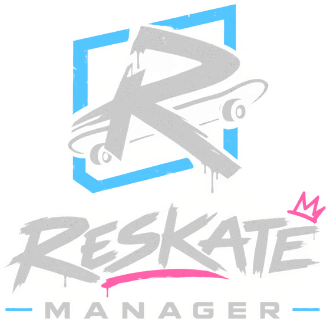
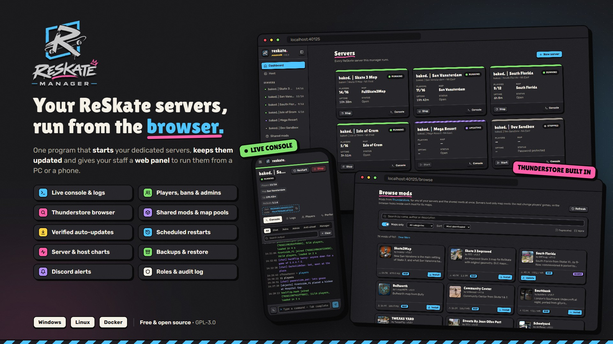

<div align="center">
  

  <p><strong>Run and manage <a href="https://github.com/Dingo-Shenanigans/ReSkate">ReSkate</a> dedicated servers from your browser.</strong></p>

  <p>
    <a href="https://github.com/xThrasherrr/ReSkateManager/actions/workflows/ci.yml"></a>
    <a href="https://github.com/xThrasherrr/ReSkateManager/releases/latest"></a>
    <a href="LICENSE"></a>
  </p>
</div>

---

ReSkateManager is a single program that starts your ReSkate servers, keeps them up to date, and gives your staff a web panel to run them. It runs on Windows, Linux and Docker, and manages several servers side by side, each in its own folder with its own ports.



## Table of contents

- [Features](#features)
  - [Console and logs](#console-and-logs)
  - [Players and server control](#players-and-server-control)
  - [Performance and monitoring](#performance-and-monitoring)
  - [Server settings and maps](#server-settings-and-maps)
  - [Mods](#mods)
  - [Updates and backups](#updates-and-backups)
  - [Users, roles and alerts](#users-roles-and-alerts)
  - [Plugins](#plugins)
- [Getting started](#getting-started)
  - [Windows](#windows)
  - [Linux](#linux)
  - [Docker](#docker)
- [Configuration](#configuration)
  - [Where everything is stored](#where-everything-is-stored)
  - [Exposing the panel](#exposing-the-panel)
  - [Settings, environment and flags](#settings-environment-and-flags)
- [Backups and restoring](#backups-and-restoring)
- [Writing plugins](#writing-plugins)
- [Troubleshooting](#troubleshooting)
- [How it works](#how-it-works)
- [Development](#development)
  - [Requirements](#requirements)
  - [Common tasks](#common-tasks)
  - [Project layout](#project-layout)
- [Contributing](#contributing)
- [License](#license)

## Features

### Console and logs

- **Live console:** server output streamed live and color-coded by type, with filters and search. Run commands with history and Tab completion, or switch to server chat. It opens on the newest lines, and **Clear** only hides output in your browser.
- **Logs:** read a server's own `ReSkateServer.log`, or everything the console showed while the manager ran it, Steam's lines included. Filter by time range and line type, search, then export what's shown or download a whole log file.

### Players and server control

- **Player management:** see who's online and who has played, with each player's role from ReSkate 2.0.6, their playtime, and the throwdowns they played and won (a quit counts for nothing; counted while the server's player activity log is on), on that server and on all of yours. Kick (from 2.0.8 for as long as you pick, or the server's own kick time), ban, unban and manage in-game admins, which from 2.0.6 are the players with the server's `admin` role. From 2.1.0, lock noclip, No Bail, the boosts or physics tuning for one player, also one who left, and see whose tools are locked.
- **Crash recovery:** a crashed server restarts automatically, with backoff, up to five tries in a row.
- **Scheduled restarts:** restart a server at set times of day, or after so many hours up. Players get a warning in chat 10, 5 and 1 minute before; a server with nobody on restarts straight away.

### Performance and monitoring

- **Performance:** CPU, memory and player charts from the last hour up to 7 days, plus a summary of each run. Every server process is sampled every 30 s.
- **Network health:** bandwidth in and out, the worst player's ping, send-queue delay, lost sends and how busy the server's main loop is — charted on each server's Performance tab. Needs ReSkate 1.1.5+ with **Log player activity** on, so it shows what was happening before players noticed trouble.
- **Host performance:** one page for the machine the manager runs on — its CPU and memory over time with each server's share stacked underneath, the manager's own memory, servers running and players online. Memory the system only holds as cache counts as free. In Docker it shows the whole host plus the container's memory limit, if any. Below that, each drive the manager uses: free space, and what servers, shared mods, backups, releases and logs take up (refreshed at most every 10 minutes). Owners see this page by default; a role can grant it to others.

### Server settings and maps

- **Settings editor:** a form for every `ReSkateServer.json` setting. Most changes apply live through the server's own console commands. A few with no command (`max_players`, ports, `steam_token`, `global_bans`) go through a safe stop → write → start instead. Only owners can see or change a server's `steam_token`, its custom votes or its chat commands (ReSkate 2.0.3's own `/discord`, `/rules` and the like), which run server commands. ReSkate 2.0.6's park mods (parks built in the game's Park Editor, spawned for everyone) are set up live too.
- **Map pool and rotation:** pick which maps players can vote for and how long the server stays on each, and from ReSkate 2.0.7 whether players vote for the next map and can vote to stay longer. Edits apply live, admin changes included. The manager warns before you disable or delete a mod whose map is in a pool, since the server won't start without it.
- **World controls:** time of day and every world layer per map, applied live or saved for the next start (needs `world-layers.json` next to the server, which comes with the server's release and is replaced by each update).

### Mods

- **Mod browser:** search Thunderstore's ReSkate mods, tick any of your servers and the shared mods, and install one on all of them at once. Shows the maps a mod adds before you download it, and can filter to mods that add maps.
- **Mods:** upload map mods as zips, sent in chunks so large maps clear proxy upload limits such as Cloudflare's. Enable, disable or delete mods, set a mod's map as the server's map, and update one mod or every outdated mod (**Update all**) in the background. From ReSkate 2.0.7, **Load them now** has a running server pick up changed mods without a restart.
- **Launcher profiles:** from ReSkate 2.0.8, hand players the maps a server loads as one launcher profile, a code or a `.r2z` file they import in the ReSkate launcher (or r2modman) to download them all at the server's versions. A profile works the other way too: paste its code or pick its file to install its mods on a server, with the ones that add maps ticked.
- **Shared mods:** keep one copy of a mod for several servers. Each server loads all, some, or none of them. Moving a server's mod into the shared pool (or turning shared mods on) swaps duplicate copies for links, reclaiming space.

### Updates and backups

- **Updates:** install new server releases on demand or automatically once a server is empty, each verified against the release's SHA-256 hashes. Owners can update the manager itself from the panel, which brings its servers back up afterward. The old binary stays as `.old` for ten minutes; a server update that fails partway restores the previous files.
- **Backups:** daily backups of the database, settings and each server's config, kept for the last seven — mods can be included too. Full details in [Backups and restoring](#backups-and-restoring).
- **Move a server:** export a server as a zip (settings, announcements and mods) and import it on another manager. Also covered in [Backups and restoring](#backups-and-restoring).
- **Housekeeping:** the audit log is kept 90 days and player history 180 days, both adjustable on the Manager page. Performance samples keep a week, and the release cache keeps the two newest downloads.

### Users, roles and alerts

- **Users and roles:**
  - Sign in with Steam or a password.
  - Roles grant access per server or on all servers, and decide which tabs of a server someone sees.
  - A role with "Be an in-game admin" syncs its users to in-game admin on those servers through their linked Steam account; admins added by hand are left alone.
  - Every action is recorded in an audit log.
  - Sign-ins are rate-limited (10 failures from one address in 5 minutes, or 20 against one account in 15). Sessions last 14 days; changing a password or linked Steam account signs out that user's other sessions.
  - **Run console commands** alone covers read-only and player-movement commands (`status`, `players`, `maps`, etc.). Kick, ban, admin and chat commands need their own permission, and everything else, settings included, needs **Change server settings**.
- **Announcements:** timed chat messages, such as a Discord invite, for one server or all of them, sent only while players are online. From ReSkate 2.0.2 each can also show as a card on every player's screen (from 2.0.3 as a card only), or stay in chat only; the server's own list of announcements is on its settings page.
- **Discord alerts:** a webhook notifies a channel on a crash, repeated crashes or a server stopping itself; on a server or manager update installing or failing; on a failed scheduled backup; and on low disk space (10 GB free by default) or sustained high memory (90% for 10 minutes by default, the container limit included in Docker) — each firing once when it starts and once when it clears. Any alert type can be turned off, and a test button checks the webhook.
- **Discord status message:** a bot keeps one message in a channel up to date with each server's state, players, map, join code, ReSkate version, uptime and next restart. It's edited at most once a minute, shows when it was last updated (so an old time means the manager isn't running), and marks every server offline when the manager stops. Owners set it up under **Manager**:
  1. In the [Discord Developer Portal](https://discord.com/developers/applications), create an application, then on its **Bot** page reset the token and copy it.
  2. Paste the token into the panel, then follow **Invite the bot** to add it to your Discord server. It asks only for View Channel, Send Messages and Embed Links.
  3. In Discord, turn on Developer Mode (User Settings, Advanced), right-click the channel, choose **Copy Channel ID**, and paste it into the panel.

  Once saved, the token is never shown again. The message's title is yours to change, and join codes can be hidden; a server with a password still asks for it. If Discord turns the bot away, the card says why. A refused token or a wrong channel ID stops it until you change them; a bot that can't see the channel yet, such as one not invited, is tried again every few minutes.

### Plugins

- **Plugins (preview):** Lua 5.4 scripts in `plugins/` that run inside the manager and act on what happens on your servers: players joining and leaving, chat, throwdowns, map and state changes. They can read who is on, and chat, message, kick, ban, teleport and run commands with what an owner grants each one. They keep values of their own, read players' playtime, rank players on leaderboards across your servers or on one, show players cards and answer their `/commands`. Owners add them under **Manager** as a zip, or copy them into `plugins/`, and turn each one on there, where its card shows what it may do, its log, its errors and how busy it is. See [Writing plugins](#writing-plugins).

## Getting started

Download the latest build from the [releases page](https://github.com/xThrasherrr/ReSkateManager/releases/latest). On first run the manager prints a one-time **setup PIN**. Open the panel and enter it to create the owner account.

Release candidates, such as `1.0.0-rc.1`, are published as pre-releases. A release never updates itself to one, and the image's `latest` tag stays on the last release. A candidate updates itself to the next candidate, then to the release. To try one in Docker, use its tag, such as `ghcr.io/xthrasherrr/reskate-manager:1.0.0-rc.1`.

### Windows

1. Unzip `ReSkateManager-<version>-windows-amd64.zip` anywhere and run `ReSkateManager.exe`.
2. Your browser opens to the panel with the setup PIN already filled in. The console window shows the panel address and the PIN too.
3. A tray icon reopens the panel. Its **Stop servers and quit** item shuts everything down cleanly.

### Linux

The release archive includes `reskate-manager.service`, a systemd unit with install steps at the top of the file.

```sh
sudo useradd --system --home /opt/reskate-manager reskate
sudo cp ReSkateManager /opt/reskate-manager/ && sudo chown -R reskate: /opt/reskate-manager
sudo cp reskate-manager.service /etc/systemd/system/
sudo systemctl enable --now reskate-manager
journalctl -u reskate-manager    # the setup PIN is printed here
```

- Servers install and update from the release's `ReSkateServer-Linux-<version>.tar.gz`, verified against the SHA-256 that GitHub records for it.
- Before a server starts, the manager links `~/.steam/sdk64/steamclient.so` to the server folder's copy, as `setup-linux-server-libs.sh` would. A working link that's already there is left alone.

### Docker

```sh
docker compose up -d             # uses compose.yaml from this repository
docker compose logs manager      # the setup PIN is printed here
```

- The image is `ghcr.io/xthrasherrr/reskate-manager`. Build it locally with `docker compose build`.
- All data lives in the `/data` volume. A bind mount must be writable by uid 1000.
- UDP `27015-27024` covers five servers. Host and container port numbers must match.
- The manager doesn't update itself in a container. To update, run `docker compose pull && docker compose up -d`.
- `docker stop` lets each server log off Steam. The compose file allows 45 s for that.
- Scheduled restart times, and when plugins' boards start a new week and month, follow the container's clock, which is UTC unless you set `TZ` in `compose.yaml`, such as `TZ: Europe/Berlin`.

## Configuration

Everything the manager keeps sits next to the executable, or under the directory given with `--root`.

### Where everything is stored

```
data/manager.toml   settings (listen address, public URL, TLS)
data/manager.db     servers, users, roles, sessions, announcements, performance and network samples, audit log, player history, visits and throwdowns
data/manager.log
data/plugins.log    what plugins log, and why one was stopped
data/manager.lock   held while the manager runs, so a second one can't use the folder
servers/<id>/       one folder per server: ReSkateServer.exe, ReSkateServer.json, Mods/, ReSkateServer.log, console.log
shared/Mods/        shared mods, linked into the Mods/ of each server that uses them
plugins/<id>/       one folder per plugin: plugin.toml, main.lua and its other .lua files
backups/            backups, one zip each
cache/              downloaded server releases (the newest two are kept)
```

### Exposing the panel

The panel listens on `0.0.0.0:40125` by default. To expose it to the internet, serve it over HTTPS:

- **Behind a reverse proxy:** the last setup step asks how people open the panel; owners can change it later under **Manager**. It sets `proxy` (`"cloudflare"` behind Cloudflare, Cloudflare Tunnel included, or `"forwarded"` behind nginx, Caddy, Traefik and the like) and `public_url`, which Steam sign-in needs. With Docker you can set `RSM_PROXY` and `RSM_PUBLIC_URL` in `compose.yaml` instead. Make sure only the proxy can reach port 40125: with a tunnel on the same machine, `listen = "127.0.0.1:40125"` (or publish the port as `127.0.0.1:40125:40125`). The manager reads the visitor's address only from requests that come from this machine, a private network or, with `cloudflare`, Cloudflare's own servers, and logs a warning when one arrives from anywhere else.
- **Directly:** set `tls_cert` and `tls_key`.

Steam sign-in sends people back to `public_url`, so it needs the panel's address set, on any network: an owner sets it under **Manager**, such as `http://192.168.1.20:40125` at home. Only on the manager's own machine, through `localhost`, does it work without one.

### Settings, environment and flags

`data/manager.toml` is written on first start, with a note on each setting. Restart the manager after editing it.

| Setting | Default | What it does |
| --- | --- | --- |
| `listen` | `"0.0.0.0:40125"` | The panel's address and port |
| `public_url` | `""` | The address people open the panel at, such as `https://panel.example.com`. Steam sign-in needs it |
| `proxy` | `""` | The reverse proxy in front of the panel: `"cloudflare"`, `"forwarded"` or `""` for none |
| `tls_cert`, `tls_key` | `""` | PEM files to serve the panel over HTTPS directly; set both or neither |
| `open_browser` | `true` | Opens the panel when the manager starts on a desktop |
| `update_repo` | `"Dingo-Shenanigans/ReSkate"` | The GitHub repository whose releases carry the ReSkate server |
| `manager_repo` | `"xThrasherrr/ReSkateManager"` | The GitHub repository the manager updates itself from; `""` stops it looking |

| Environment | What it does |
| --- | --- |
| `RSM_PROXY`, `RSM_PUBLIC_URL` | Take the place of `proxy` and `public_url`, as in `compose.yaml` |
| `RSM_ROOT` | The folder to use when `--root` isn't given. The Docker image sets `/data` |
| `RSM_NO_SELF_UPDATE` | Any value stops the manager updating itself. The Docker image sets it: a new image is the update |

| Flag | What it does |
| --- | --- |
| `--root <folder>` | Where `data/`, `servers/` and the rest live; next to the executable by default |
| `--no-tray` | No tray icon (Windows) |
| `--no-browser` | Doesn't open the panel |
| `--restore <backup.zip>` | Restores a backup, then exits (see [Backups and restoring](#backups-and-restoring)) |
| `--launcher-json <file or URL>` | Takes server releases from this `launcher.json` instead of the latest release, to try one before it's published |
| `--version` | Prints the version and exits |

From 1.0 on, these names, the folder layout above, the backup format, the systemd unit's name and port 40125 stay as they are in every 1.x release, so an upgrade needs no changes on your side. The REST API behind the panel isn't one of them: it's internal to the panel and can change in any release.

## Backups and restoring

A backup is a zip in `backups/`, laid out like the manager's folder: `data/manager.db`, `data/manager.toml`, `plugins/<id>/` with each plugin's files, and `servers/<id>/` with each server's `ReSkateServer.json` and `world-layers.json`. Server programs are never in it, since they download again. Mods are in it only when you include them, as `servers/<id>/Mods/` and `shared/Mods/`. Owners set the schedule and how many to keep under **Manager**. The ones you make by hand stay until you delete them. A backup on the same disk won't survive that disk, so download one now and then, or mount another disk at `backups/`.

- **One server:** open its **Server** tab, stop it, and choose **Restore** on a backup. Its config and world layers go back as they were. With a backup that holds mods, its own mods are swapped for the backup's, and shared mods the manager no longer has come back. Servers without a program can install it again from the same dialog.
- **Everything:** stop the manager, then run it with `--restore` and the backup. It puts back the database and `manager.toml`, then each server's config and mods, and the shared mods and plugins that are missing. The database it replaces is backed up first. Everyone signs in again afterwards: the sessions in the backup are dropped, since some may have been ended since it was made. A backup from a newer manager, or a damaged database, is refused before anything is replaced, and so is a restore while a manager is running with the folder. A server whose folder was in the old `servers/` lands in this manager's, so a backup made on Windows restores into Docker too. Start the manager again afterwards.

  ```sh
  # Windows (in the manager's folder)
  ReSkateManager.exe --restore backups\backup-20261005-040000-scheduled.zip

  # Linux
  sudo systemctl stop reskate-manager
  sudo -u reskate /opt/reskate-manager/ReSkateManager --root /opt/reskate-manager --restore /opt/reskate-manager/backups/backup-20261005-040000-scheduled.zip
  sudo systemctl start reskate-manager

  # Docker; the cp is only needed for a backup that isn't in the volume
  docker compose stop manager
  docker compose cp backup-20261005-040000-scheduled.zip manager:/data/restore.zip
  docker compose run --rm manager --restore /data/restore.zip
  docker compose start manager
  ```

  To do it by hand instead, stop the manager, copy `data/manager.db` and `data/manager.toml` from the zip into `data/`, and delete `data/manager.db-wal` and `data/manager.db-shm` if they're there.
- **Moving a server to another manager:** on its **Server** tab choose **Export**, then on the other manager **New server**, **From an export**. It arrives in a new folder with its name, settings, announcements and mods, the shared ones it loaded included. Ports another server there already uses are changed.

## Writing plugins

A plugin is a folder in `plugins/` (in Docker, the volume's `plugins/`) holding a `plugin.toml` and a `main.lua`. The folder's name is the plugin's ID. It shows on the Plugins card under **Manager** straight away, turned off; an owner turns it on, and **Reload** reads its files again after you change them.

You don't need to reach the machine or the Docker volume: **Add plugin** on the card takes a `.zip` of the plugin's folder (up to 4 MB), or of the files in it, in which case the zip's name is the ID. A plugin added this way starts off. Adding one that's there already asks first, then replaces its files and, if it was on, starts it again with them; what it was granted stays, and anything new its `plugin.toml` asks for waits for an owner to tick it. **Remove** stops a plugin and deletes its folder.

```toml
# plugin.toml
name = "Welcome"
version = "1.0.0"
api = 0                      # the plugin API it was made for
description = "Says hello."
servers = ["skate-3"]        # server IDs; leave it out for all of them
permissions = ["players.chat"] # what it asks to do, granted on its card
commands = ["top"]           # chat commands it answers, as /top
```

```lua
-- main.lua
on("player.joined", function(e)
  log(e.name .. " joined " .. e.server)
  server.msg(e.server, e.id, "Welcome, " .. e.name)
end)

every(60, function() log("still here") end)
```

**Plugin API 0 is a preview:** it may change from one release to the next, and a plugin made for it may need changes. Once it's settled it becomes API 1, which then only grows. A plugin made for an API this manager doesn't run won't start, and its card says so.

What a plugin can call:

| Call | What it does |
| --- | --- |
| `on(event, fn)` | Calls `fn(e)` each time `event` happens on one of the plugin's servers |
| `command(word, fn)` | Calls `fn(e)` each time a player types `/word` on one of the plugin's servers: `e.id` and `e.name` are theirs, `e.args` the words after it and `e.text` all of them. The word must be in `commands` in `plugin.toml` |
| `after(seconds, fn)` | Calls `fn()` once, that long from now; returns the timer |
| `every(seconds, fn)` | Calls `fn()` every so many seconds, 0.1 at least; returns the timer |
| `cancel(timer)` | Stops a timer; true if it was still going |
| `log(...)`, `warn(...)` | Writes a line to the plugin's log: its card and `data/plugins.log`. `print` is `log` |
| `require(name)` | Runs one of the plugin's own files once, `"lib.util"` being `lib/util.lua`, and returns what it returned |
| `server.list()` | Each of the plugin's servers, as `server.info` gives it |
| `server.info(id)` | A server: `id`, `name`, `state`, `players` (how many), and `map`, `slots` and `started_at` once known |
| `server.players(id)` | Who is on it, first in first, each as `player.joined` gives them |
| `server.say(id, text)` | Says `text` in the server's chat |
| `server.msg(id, steamId, text)` | Sends one player a message, shown to them as "[DM from Server]" |
| `server.kick(id, steamId [, minutes])` | Kicks a player, kept out that long (1-1440, or 0 until the server restarts) or as the server's settings say. Before ReSkate 2.0.8 every kick lasts until the server restarts, so a time is refused |
| `server.ban(id, steamId)`, `server.unban(id, steamId)` | Bans or unbans a SteamID64, on the server or not |
| `server.teleport(id, steamIds, to)` | Teleports a player or a list of up to 64 to a player (a SteamID64) or a place, `{x =, y =, z =}` with `y` up. Several stand in a ring round it |
| `server.role(id, steamId, role)` | Gives a player one of the server's roles, or `"none"` |
| `server.roles(id)` | The server's roles, each `{name, tag, color, rank}`, or `nil` and why on a server without roles |
| `server.makerole(id, {name, tag, color, rank})` | Adds a role with what the default role has, or sets the tag, colour (`"#RRGGBB"`) and rank given of one there is, as **Add role** and **Edit role** do on the Players page. A running server reads its roles again at once |
| `server.command(id, line)` | Runs a console line |
| `store.get(key)`, `store.set(key, value)` | Reads or keeps one of the plugin's own values, which outlive restarts: `nil`, a boolean, a number, a string, or a table of those. Setting `nil` deletes it |
| `store.delete(key)` | Deletes a value; true if it was there |
| `store.keys([prefix])` | The plugin's keys, sorted, or those that start with `prefix` |
| `playtime.total(steamId [, server])` | A player's seconds on your servers, or on one, a visit going on now included |
| `playtime.sessions(steamId [, limit])` | Their latest visits, newest first (10, or up to 100): `server`, `joined_at`, and `left_at` and `reason` once it's over |
| `stats.define(board, {title, unit, keep, public})` | Makes a board of the plugin's. `keep` is `"sum"` (the default: scores add up), `"best"` (the highest counts) or `"fastest"` (the lowest) |
| `stats.add(board, server, steamId, n)` | Gives a player `n` on one of the plugin's boards, on the server it happened on |
| `stats.top(board [, {server, period, limit}])` | A board's first players (10, or up to 100), each `{rank, id, name, value}` |
| `stats.rank(board, steamId [, {server, period}])` | A player's rank and score on a board, or `nil` when they aren't on it |
| `stats.around(board, steamId [, {server, period, limit}])` | The players about a player's place (5, or up to 100), theirs in the middle where there's room |
| `ui.card(id, steamId or "all", card)` | Shows one player, or everyone, a card at the top of the screen: `card` is text, or `{title =, lines = {...}}` |
| `discord.post(webhook, card)` | Posts a card to a Discord channel through one of its webhooks, as a message with the title on top and each line under it |

A board covers all your servers: a sum adds a player's scores up from every server, a best takes their highest and a fastest their lowest. `{server = id}` reads one server's instead, and `{period = "month"}` or `{period = "week"}` this calendar month or the week from Monday instead of all time, each from midnight on the manager's clock (in Docker, UTC unless `TZ` is set). Players with the same score share a rank, whoever got there first listed first. Every plugin can read `playtime`, a board of everyone's time on your servers, from the panel's own record of visits. A board belongs to the plugin that defined it first: only that one adds to it, its `keep` can't change, and every plugin reads it. `public` lets a board out of the panel: `GET /api/boards` gives `playtime` and every public board across all your servers, each with its first players' `rank`, `name` and `value` and no SteamIDs, to anyone signed in with `players.view` on all servers, such as a website's read-only panel user. It takes `?period=all|month|week` and `?limit=` (10, up to 100).

Boards are read from a snapshot, worked out again once something is added (a read waits up to 50 ms for it, then takes the one before) or once it's 30 seconds old. A read that can't be answered returns `nil` and why: `local rows, err = stats.top("wins")`. What plugins keep is written within a second, so a crash loses that second at most. Removing a plugin keeps its store and its boards, so adding it again brings them back.

A plugin that replaces others, such as one made from two you ran before, says so in its `plugin.toml`: `takes = {cheers = "cheers."}`. As it starts, each one's store moves into its own, every key with the prefix given (64 bytes at most) before it, and their boards become its own. It doesn't start while one of them is still installed. A plugin whose keys can't all move, because the new one has one of them already or one would be longer than 256 bytes, keeps its store, and the log says why; the next start tries again.

A server shows one card at a time, whoever it's for, so cards wait their turn: the manager's own announcements first, then plugins' cards in the order they came, each once the card up now is down. That includes cards the server puts up itself, such as its timed announcements. A card waits a minute at most, and a plugin can have 16 waiting. Today's servers show a card as one line under their ANNOUNCEMENT title, its title and lines joined with " · " and cut at 200 bytes, for 6 to 15 seconds as it's longer, and not to a player with chat off or a menu open: a welcome is best sent some seconds after the join, with `after`.

A plugin's commands are the server's own chat commands (ReSkate 2.0.3 on), which it reads as it starts: the manager puts the words of the plugins that are on in each server's config before starting it, so a new word works from a server's next start. The owner's own chat commands come first, then the plugins' by ID; a word another has already, one of the server's own, or one past the server's 32 is left out, and the plugin's log says why. **Settings** shows the plugins' words among the chat commands, locked. A player using the same command again within a second isn't heard, so nobody can make a plugin flood chat.

Events, each with `e.server`, the server's ID. Times are unix seconds, and `id` is a player's SteamID64:

| Event | `e` holds |
| --- | --- |
| `player.joined` | `id`, `name`, `admin`, `joined_at`, and `role` when they were given one |
| `player.left` | `id`, `name`, `reason`, `joined_at`, `left_at`, `seconds` |
| `chat` | `name`, `text`, and `id` when the name is one player's: on the server, or who left it this run |
| `map` | `map`, when everyone has loaded it |
| `state` | `state` and `was`: `starting`, `running`, `stopping`, `stopped`, `crashed` or `updating`; `map` once known |
| `throwdown.placed`, `.removed`, `.joined`, `.left`, `.started`, `.quit`, `.lead`, `.scored`, `.landed`, `.missed`, `.finished` | `kind`, `mode` (`jam`, `spot_battle`, `skate`), `leader` and `player` as `{name, id}`, and by kind `points`, `round`, `best`, `turn`, `queue`, `near`, `players` or `results` (each `{name, id, place, points, quit}`, or `landed` and `missed` for S.K.A.T.E.). Needs the server's **Log player activity** on |

`server.*` and `ui.*` calls name a server first, by its ID: an event's `e.server` is the one it happened on, and a plugin limited to some servers can't reach the others. Reading needs nothing. The other calls send a command, and each needs a permission the plugin asks for in `permissions` and an owner grants it on its card:

| Permission | Calls |
| --- | --- |
| `players.chat` | `server.say`, `server.msg`, `ui.card` |
| `players.kick` | `server.kick` |
| `players.ban` | `server.ban`, `server.unban` |
| `ingame.admins.manage` | `server.role` |
| `console.exec` | `server.teleport`, `server.command` |
| `settings.edit` | `server.command` for lines that change settings |
| `discord.post` | `discord.post` |

`server.command` needs what the panel's console asks of the person typing the line: `console.exec`, and for a line that kicks, bans, chats, gives roles or changes settings, that permission as well. Plugins can't run `poll-run`, `quit` or `update`. A call the plugin wasn't granted raises an error that says what to grant.

`discord.post` is the one permission that isn't the panel's own: it's a plugin's only way out to the network, and only to a Discord webhook's address (`https://discord.com/api/webhooks/...`), which the plugin names. Its lines show as written, with Discord's formatting escaped; its title isn't escaped, so put what players typed in the lines. It pings nobody, `@everyone` included. Posts go one at a time in the order made, waiting out Discord's rate, with up to 16 waiting; a function given last hears `fn(true, "Posted.")` or `fn(false, why)`. Each shows in the audit log as `plugin:<ID>`'s `plugin.discord`, without the webhook.

Commands are sent after the call returns, in the order made, with the panel's: the call returns `true` once it's queued, or `false` and why when too many are waiting. A function given last is called with what came of it, `fn(ok, reply)`: `ok` is false when the server didn't get it, wasn't running or didn't know the command, and `reply` is the server's answer (which may say it couldn't, as "No single connected player matches ...") or why it failed. Without one, a command that failed goes in the plugin's log. Each command shows in the server's console and the audit log as `plugin:<ID>`'s.

The limits it runs under:

- A plugin is Lua 5.4 and the plugin API, nothing more: the `string`, `table`, `math`, `utf8` and `coroutine` libraries, without `io`, `os`, `debug`, `package` or loading code from text or bytecode. It can't reach files outside its folder, other programs or the network, other than Discord webhooks through `discord.post`.
- One call into a plugin (an event, a timer or its `main.lua`) may run for 100 ms. One that runs over is cut off wherever it is, and the plugin starts afresh; three times in 10 minutes and it's stopped. One that fails 20 times in a minute is stopped too. A stopped plugin stays on, so **Reload** or the next start of the manager tries again.
- A plugin may use 64 MB. Past that, Lua raises "not enough memory" in it.
- Each plugin has its own queue of 256 events. A plugin too busy to keep up drops events, which its card counts, and never slows a server or another plugin.
- A plugin sends its servers 4 commands a second, after 8 at once, with up to 64 waiting; past that a call returns `false`, and its card counts them. Chat is cut at the server's 200 bytes, on one line.
- A plugin's store holds 1 MB: 64 KB a value and 256 bytes a key. Up to 10,000 of its scores wait to be written at once; past that `stats.add` returns `false`.
- Turning on a plugin runs its code inside the manager, as installing a mod runs it inside the game. Only owners can, and only turn on plugins you trust.

## Troubleshooting

### Steam sign-in

- **"Steam sign-in needs the panel's address":** an owner sets it under **Manager** (or `public_url`, or `RSM_PUBLIC_URL` in Docker) to exactly what people type, such as `https://panel.example.com`. Steam sends people back to that address and nowhere else, so a panel opened under another name, an IP address or `www.` in front, can't finish signing in.
- **Behind a proxy:** set how people reach the panel under **Manager** as well (`proxy`: `cloudflare` or `forwarded`). Without it the manager takes every visitor for the proxy, and one person's failed sign-ins make everyone wait.
- **"Couldn't reach Steam to confirm the sign-in":** the manager checks each sign-in with `steamcommunity.com`, so the machine it runs on needs to reach it over HTTPS.
- **"That Steam account isn't linked to anyone on this panel":** sign in with a password and link the account on the **Account** page, or ask an owner to add the SteamID64 to the user.

### Ports and firewalls

- **The panel:** TCP 40125, or what `listen` says. Open it only to people who should reach the panel. Behind a proxy or tunnel on the same machine, listen on `127.0.0.1` so only the proxy can.
- **Each server:** a game port and a query port, both UDP, a pair from 27015 up: 27015 and 27016 for the first server, 27017 and 27018 for the next. A server's **Settings** tab shows its own. Players join over Steam's relay without them, but open them for the server browser's ping and faster joins. In Docker, host and container ports must match.
- **Windows:** the first start of a server may bring up a firewall prompt for `ReSkateServer.exe`. Allow it on the networks players come from.

### Linux and `steamclient.so`

- The server loads Steam from `~/.steam/sdk64/steamclient.so` of the user it runs as. Before each start the manager links that to the server folder's copy when nothing usable is there, so the service user needs a home folder it can write to, as the `useradd` line above gives it.
- If the console says **Could not link steamclient.so**, make the link yourself as that user, or run the release's `setup-linux-server-libs.sh`.
- A link that already works is left alone, even one to an older Steam client. If servers stop signing in to Steam after an update, delete `~/.steam/sdk64/steamclient.so` and the manager links the new one at the next start.

### The manager won't start

- **"another manager is already running with …":** one manager runs per folder. Stop the other, or give this one a folder of its own with `--root`.
- **"cannot listen on …":** another program holds the port. Change `listen` in `data/manager.toml`.

If the panel says it can't reach the manager, the manager stopped or is restarting, or a proxy in front of it is down. The panel keeps trying, and picks up again once the manager answers.

## How it works

ReSkateServer has no admin API, so the manager works entirely through each server's console.

- **Launch:** servers start with redirected stdin/stdout and `--no-update`, and on Windows `--headless`, without which ReSkate 2.0.6 opens a window of its own. The manager installs updates itself, because the server's self-updater relaunches it under a process the manager can't track. A server that closes its console while it runs (the Windows build did in 2.0.6 and 2.0.7) is ended and not restarted, since the manager could neither read nor stop it.
- **Output:** stdout lines (`[HH:MM:SS] text`, or the time as Windows shows it from 2.0.6) are parsed into typed events: joins, leaves, chat, admin commands, anti-cheat, votes and readiness. The formats come from `Server/server_host.cpp`. A line over 1 MiB is cut there, so it can't stall the reader or the server.
- **Commands:** commands go to the server one at a time, and each reply is matched to the command that produced it. Lines the server prints on its own are never taken as replies.
- **Config file:** the server rewrites `ReSkateServer.json` after every setting command, so the manager never writes that file while the server is running. Before a start, the manager fixes a server name the server would refuse (letters, numbers, spaces and `- _ / [ ] ( )` only) by dropping the other characters, and says so in the console.
- **Stop:** the manager sends `quit` so the server warns players and logs off Steam. If it hasn't exited after 15 s, it is killed.
- **Logs:** `ReSkateServer.log` rotates at 10 MB, keeping three old logs. After a manager restart, each console opens with the end of that log. The server writes only its own lines there, so while it runs the manager also writes everything the console shows to `console.log`: lines Steam prints too, the manager's notes and the commands sent, with who sent them. That one rotates at 10 MB as it goes, keeping three as well, and so does the manager's own `data/manager.log`.
- **Shared mods:** a server that uses them gets a link to each shared mod in its `Mods/`: a directory junction on Windows, which needs no admin rights, and a symlink elsewhere. The server reads a linked mod like any other. Links are checked when the manager starts and before each server starts, so a mod copied into `shared/Mods/` by hand reaches the servers at their next start. Deleting a link, or a whole server, never touches the shared copy.
- **Network health:** each server's `[network]` line is kept per run. The failed, skipped and dropped sends in it are totals since the server started, so the charts count each minute's from the line before.
- **Mods from Thunderstore:** the manager downloads a mod itself and installs it in the background while the panel follows its progress, so a big map isn't cut off by a proxy's time limit on one request (Cloudflare's is 100 s). To list a mod's maps, it reads only the zip's directory and its `reskate-levels.json` with HTTP range requests, usually a few hundred KB, from where Thunderstore stores the zip. That way looking doesn't count as a download. A few mods with long names are stored under names the manager can't work out; their maps show once installed.
- **Orphans:** on Windows every server runs in a job object, so none outlives the manager.
- **Plugins:** each runs in a copy of PUC Lua 5.4.8 compiled to WebAssembly and run by [wazero](https://wazero.io), on a goroutine of its own, so no cgo is needed and a plugin reaches nothing the manager doesn't hand it. Its memory is reserved outside the manager's own and capped. Running WebAssembly can't be paused from outside, so every few thousand steps (loop steps, calls, pattern-match and sort steps) and at every call of a C function, Lua asks the manager whether to go on. That's when Go's scheduler and garbage collector get their turn, and when a call that ran over ends, past any `pcall`. The servers' events reach plugins in order, through each plugin's own queue. `task lua:wasm` rebuilds `lua.wasm` from Lua's source and wasi-sdk, both pinned by checksum, in a Linux container.

## Development

### Requirements

- Go 1.27+
- Node 22.17+ and pnpm 9
- [Task](https://taskfile.dev) (optional)

### Common tasks

```sh
task dev:api    # manager on :40125, data in ./dev
task dev:web    # panel with hot reload on :5173, proxied to the manager
task check      # go vet, go test, svelte-check
task build      # bin/ReSkateManager(.exe) with the panel embedded
task lua:wasm   # rebuild the plugins' Lua (needs Docker)
```

Without Task: `cd web && pnpm install && pnpm build`, then `go build ./cmd/ReSkateManager`.

### Project layout

| Path | Purpose |
| --- | --- |
| `cmd/ReSkateManager` | Entry point and Windows tray |
| `cmd/reskate-watch` | What a new ReSkate release changes for the manager; checked hourly by the ReSkate watch workflow, which files an issue when there's work |
| `internal/supervisor` | Process, pipes, graceful stop, Windows job object |
| `internal/logparse` | stdout → typed entries; `players` and `maps` replies, `[network]` summaries |
| `internal/logfile` | Logs that rotate themselves: `console.log`, `data/manager.log` |
| `internal/instance` | Per-server state machine, console history, roster, command/reply matching |
| `internal/serverconfig` | `ReSkateServer.json` schema, validation, settings → console commands |
| `internal/updater` | Release lookup, verified download, staged install |
| `internal/perf` | CPU, memory and player samples for the performance charts, per server and for the machine |
| `internal/safezip` | Zip reading with caps on entry counts and sizes, for mods, backups and exports |
| `internal/lockfile` | `data/manager.lock`, which keeps a second manager off the folder |
| `internal/host` | The machine's CPU, memory and disk space, a container's memory limit, folder sizes |
| `internal/announce` | Timed chat announcements |
| `internal/restarts` | Scheduled restarts and their chat warnings |
| `internal/alerts` | Discord webhook alerts, and the watch on disk space and memory |
| `internal/discord` | The Discord status message, which a bot posts once and then keeps up to date |
| `internal/housekeep` | Retention for the audit log and player history; old releases in `cache/` |
| `internal/backup` | Backups in `backups/`, restoring from them, server exports and imports |
| `internal/plugins` | Owners' Lua plugins: finding, running and stopping them, the plugin API, events |
| `internal/plugins/luavm` | Lua 5.4 as WebAssembly: one VM per plugin, its memory, its time limit |
| `internal/thunderstore` | Thunderstore package list, downloads, and reading a mod's zip by ranges |
| `internal/auth` | Users, roles and permissions, sessions, Steam OpenID |
| `internal/adminsync` | Keeps in-game admins in step with panel roles |
| `internal/config` | `data/manager.toml` and its environment overrides |
| `internal/store` | SQLite database and migrations |
| `internal/api` | REST and WebSocket API |
| `web/` | SvelteKit (Svelte 5) + Tailwind panel |

## Contributing

Contributions are welcome, whether a bug report, an idea or a pull request.

- **Bugs and feature requests:** open an [issue](https://github.com/xThrasherrr/ReSkateManager/issues). For bugs, include your OS, the manager and server versions, and the relevant lines from `data/manager.log`.
- **Security problems:** report them privately, as [SECURITY.md](SECURITY.md) describes, not in an issue.
- **Pull requests:**
  1. Fork the repository and create a branch from `main`.
  2. Keep each pull request focused on one change.
  3. Run `task check` and make sure it passes. CI runs the same checks.
  4. Write commit subjects as `type(scope): description` in the imperative mood, for example `fix(updater): retry interrupted downloads`. Types: `feat`, `fix`, `tweak`, `refactor`, `perf`, `style`, `docs`, `test`, `chore`, `build`, `revert`.
  5. Open the pull request against `main` with a short description of what changed and why.

By contributing, you agree that your contributions are licensed under the project's GPL-3.0 license.

## License

ReSkateManager is licensed under the [GNU General Public License v3.0](LICENSE), the same license as ReSkate.
